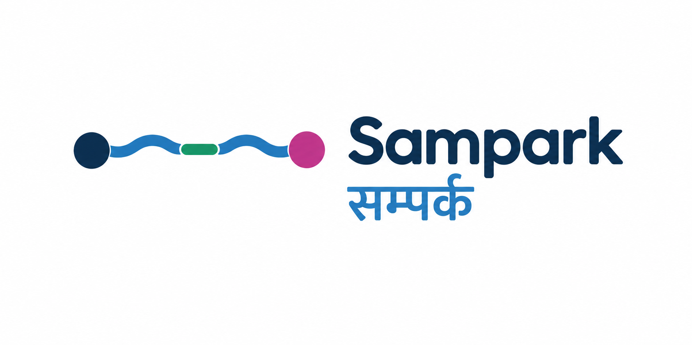

<p align="center">
  
</p>

# Sampark (सम्पर्क)

**Who can we still reach after the flood?**

Sampark maps a flood from satellite data and answers the question rescue teams ask first: which villages are cut off by road, and which road should be reopened first to reach the most people.

It was built for Track B of the Multimodal AI Hackathon 2026. The case study is the August 2026 flood and debris flows in the Bhote Koshi–Trishuli valley, central Nepal.

> **Educational prototype.** Not an operational tool. All results are satellite estimates and are not checked on the ground.

- **Live demo:** https://sampark-flood.vercel.app
- **Demo video:** _add link_
- **Access key:** browsing is open. To start a new run or use the copilot, click **Unlock** at the bottom of the left panel and enter `Access123`.

---

## What it does

1. **Maps the damage.** It compares Sentinel-1 radar images from before and after the flood. Radar sees through monsoon cloud. It marks open flood water and fresh mud and debris, and shows how sure it is.
2. **Checks what was hit.** It overlays the pre-flood OpenStreetMap roads, bridges, buildings and facilities, and marks which ones lie in the damage.
3. **Finds cut-off villages.** It builds the road network, removes damaged roads and bridges, and finds which villages can no longer reach the main road network. Some can still be reached, but only by a longer route.
4. **Plans repairs.** It ranks road stretches by how many villages and buildings each one reconnects. A what-if view shows villages coming back as you tick repairs.
5. **Explains it.** A copilot answers questions in English or Nepali. Every number in an answer is checked against the data before it is shown. A narrated story mode walks through the event on the map.

## Features

| | |
|---|---|
| **Map layers** | Flood water, mud and debris, damaged roads, cut-off villages, repair priority, confidence |
| **Before / after** | Sentinel-2 images with a slider, plus image chips on each village card |
| **Village cards** | Status, buildings affected, roads cut, and the repair that reconnects the village |
| **Repair what-if** | Tick repairs in priority order and watch villages reconnect |
| **Flood path** | Click anywhere to trace where water flows downstream on the Copernicus DEM, with the damage along the way |
| **Story mode** | A narrated, camera-guided tour of the event built from the run's own numbers |
| **Copilot** | Questions in English or Nepali. Numbers are traced to tool results, and answers that fail the check are refused |
| **Reports** | One-page report in English and Nepali, plus a data download with attributions |
| **New runs** | Pick an area and a date. A cloud worker runs the full pipeline in about 13 minutes, with live progress |

## How it works

```
Sentinel-1 (radar)  ─┐
Sentinel-2 (optical) ├─► change detection ─► flood + debris map ─┐
Copernicus DEM ──────┘   + terrain checks                        │
                                                                 ▼
OpenStreetMap (pre-event) ─► roads, bridges, buildings ─► damage check
                                                                 │
                                                                 ▼
                                     road graph ─► cut-off villages ─► repair plan
                                                                 │
                                                                 ▼
                              map · story · copilot · reports (English and नेपाली)
```

- **Radar change:** log-ratio of VV and VH backscatter between a before and after pair from the same orbit. Darkening suggests water. Brightening suggests rough new debris.
- **Terrain checks:** height above the nearest drainage and slope from the Copernicus DEM remove changes where flooding or debris is not plausible.
- **Confidence:** each mapped pixel gets low, medium or high uncertainty from how strong and how consistent the change is.
- **Routing:** the OSM road network becomes a graph. Edges hit by flood or debris, and lost bridges, are removed. Villages with no path to the network's exits are cut off.
- **Repair plan:** a greedy ranking. Each step picks the road stretch that reconnects the most buildings.

### Copilot safety

The copilot can only answer through eight tools that read this run's files. A checker extracts every number from the draft answer and matches it to a value in the tool results. If any number has no source, the answer is retried once and then refused. Nepali answers are translated with the numbers locked behind markers, so translation can never change a number.

## Validation

Results were compared with the Copernicus Emergency Management Service map for this event (EMSR927). **EMS data was used only for checking.** It was never an input, and no threshold was tuned on it.

| | Main run (gorge + Bidur) | Lower Trishuli run (Bidur) |
|---|---|---|
| Debris precision / recall / F1 (40 m tolerance) | 0.76 / 0.28 / 0.40 | 0.87 / 0.51 / 0.64 |
| Destroyed buildings found | 39% | 59% |
| Land flagged | 0.12% | 0.23% |

Compared with a plain 3 dB change baseline, Sampark flags **25 to 43 times less land**. It is precise but conservative.

**Where it struggles:** in the narrow, steep gorge (Syapru Besi and Timure) it finds only about 5% of the debris EMS mapped. In the wide valley at Bidur it is close to the baseline. We measured three reasons:

1. **Weak radar signal.** Only about 15% of gorge debris pixels change by more than 3 dB, against 35% at Bidur.
2. **Thin strips.** Narrow debris strips are lost to speckle smoothing. Only about 6% pass after filtering in the gorge.
3. **Steep slopes.** 64 to 72% of gorge debris sits on slopes over 20°, where radar geometry and the terrain mask both work against detection.

Moderate damage (EMS "damaged" and "possibly damaged") is mostly invisible to 20 m radar change.

<p align="center">
  
</p>

## Architecture

Everything runs on free tiers.

```
Browser ──► Vercel (React + MapLibre)
              │
              ▼
           Render free (FastAPI, 512 MB)  ◄── serves maps, images, copilot
              │        ▲
   start job  │        │ pull finished run
              ▼        │
     GitHub Actions ───┤──► MongoDB Atlas (status, run zips)
     (pipeline, 7 GB)  └──► Backblaze B2 (run zips, backup)
              │
              ▼
     Copernicus Data Space (openEO batch jobs)
```

- **Render** only serves finished runs. The full pipeline needs about 830 MB, so it runs on a **GitHub Actions** worker. The worker writes its progress to MongoDB, and Render shows it live.
- **Runs are stored in MongoDB and Backblaze B2**, because the free server's disk is wiped on every restart. On startup the server restores them.
- **Stop** works through MongoDB too. The worker checks every 10 seconds and cancels the Copernicus job.
- **The LLM** is Groq `gpt-oss-120b`, with Cloudflare Workers AI and Gemini as fallbacks.

## Run it locally

You need Python 3.11, Node 20+, and a free [Copernicus Data Space](https://dataspace.copernicus.eu) account.

```bash
# Backend
cd backend
python -m venv .venv
.venv\Scripts\activate          # Windows. On macOS/Linux: source .venv/bin/activate
pip install -r requirements.txt
cp .env.example .env            # then fill in the keys below
uvicorn app.main:app --port 8000

# Frontend (second terminal)
cd frontend
npm install
npm run dev                     # opens http://localhost:5173
```

### Environment

| Variable | Needed for |
|---|---|
| `CDSE_CLIENT_ID`, `CDSE_CLIENT_SECRET` | Satellite data. Without them, an interactive login opens the first time |
| `GROQ_API_KEY` (or `CF_ACCOUNT_ID` + `CF_AUTH_TOKEN`, or `GEMINI_API_KEY`) | The copilot |
| `MONGO_URI`, `MONGO_USERNAME`, `MONGO_PASSWORD` | Optional. Run storage and cloud runs |
| `B2_ENDPOINT`, `B2_KEY_ID`, `B2_APP_KEY`, `B2_BUCKET` | Optional. Backup storage |
| `PIPELINE_MODE` | `local` (default) or `github` |
| `GH_TOKEN` | Only with `PIPELINE_MODE=github` |
| `ACCESS_KEY` | Optional. Locks new runs, Stop, Delete and the copilot |
| `CORS_ORIGINS` | The frontend URL, as JSON: `["http://localhost:5173"]` |

Locally, runs execute on your own machine. A full run takes about 15 minutes, mostly waiting for the Copernicus batch jobs.

### Re-run the validation

```bash
cd backend
python -m scripts.eval_emsr describe                    # list the EMS layers found
python -m scripts.eval_emsr 20261008T063513-021f3e      # score one run
python -m scripts.diagnose_gorge                        # per-area diagnostic of the gorge misses
```

## Project layout

```
backend/
  app/          FastAPI app, routes, storage, auth, cloud-worker bridge
  pipeline/     fetch, flood map, damage, cut-off routing, repair plan, flow trace
  copilot/      agent, tools, number checker, translation, reports
  eval/         EMSR927 comparison
  scripts/      worker entry point, upload, prerender, diagnostics
frontend/
  src/          React app, MapLibre map, story mode, copilot chat
.github/workflows/
  pipeline.yml    cloud worker
  keep-alive.yml  keeps the free server awake during judging
docs/figures/   logo, banner, validation figures
```

## Data and attribution

Inputs are limited to what Track B allows:

- **Sentinel-1 GRD and Sentinel-2 L2A**, through the Copernicus Data Space Ecosystem.
- **Copernicus DEM GLO-30.**
- **OpenStreetMap**, a pre-event snapshot from 2026-07-27.

Post-event OSM and the EMS and UNOSAT products are never used as inputs.

> Contains modified Copernicus Sentinel data 2026.
>
> Produced using Copernicus WorldDEM-30 © DLR e.V. 2010–2014 and © Airbus Defence and Space GmbH 2014–2018 provided under COPERNICUS by the European Union and ESA; all rights reserved.
>
> © OpenStreetMap contributors. OSM-derived data is licensed under the ODbL.

The basemap is © OpenFreeMap, © OpenMapTiles, with data from OpenStreetMap.

## Limits

- **Satellite estimates only.** Nothing here has been checked on the ground.
- **Steep gorges are under-mapped** (see Validation).
- **OSM completeness varies.** A village or road missing from OSM is missing from the routing.
- **One radar pair.** A second orbit or a longer time series would help on steep walls.
- **Reachability is about vehicle roads.** Footpaths and river crossings are not modelled.

## Future work

- Keep unsmoothed change close to mapped river channels.
- A slope mask that adapts to the terrain.
- Combine ascending and descending orbits.
- Multi-date radar stacks.
- Walking routes and travel time, not just road links.

## AI tools used

**While building**
- **Claude (Anthropic)**, as a coding assistant. I wrote each phase and pasted drafts, logs and errors. Claude reviewed the code, found bugs, and suggested fixes and full rewritten files. It helped most with the deployment (Render, GitHub Actions worker, MongoDB and B2 storage), memory and speed fixes for the free server, the copilot's number checker, and the README. All design decisions, testing and running were done by me.
- **ChatGPT (OpenAI image generation)**, for the logo and the README banner.

**Inside the app**
- **Groq `openai/gpt-oss-120b`** is the copilot's main model. **Cloudflare Workers AI (Llama 3.3 70B)** and **Google Gemini 2.5 Flash** are fallbacks.
- The LLM only picks tools and writes sentences. Every number it shows comes from the run's data files and is checked before display. The flood maps, damage checks, routing and repair plan are rule-based code, not AI.

## License

Code: [MIT](LICENSE).
Data keeps its own licenses: Copernicus Sentinel and DEM terms, and the ODbL for OpenStreetMap data (see Data and attribution).
